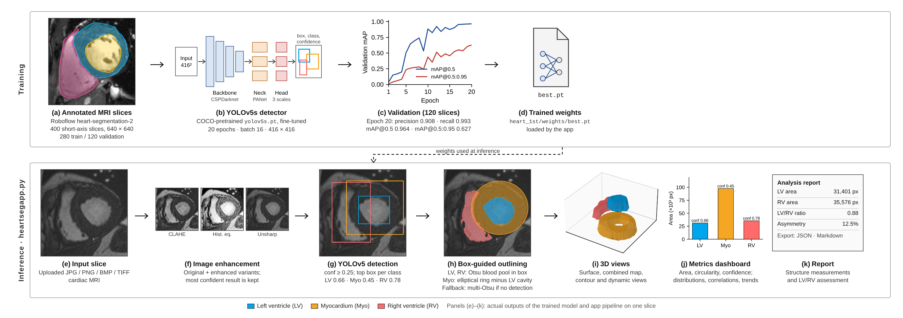

# 3D Heart Imaging App: Cardiac MRI Segmentation with YOLO

A cardiac MRI segmentation project with two parts. The first is a detection model for three cardiac structures (left ventricle, myocardium, right ventricle), trained on the YOLOv5 framework. The second is an interactive Streamlit app that segments heart images and shows the results in 2D and 3D.

> **Built on YOLOv5 by Ultralytics.** The detection framework in this repository (`models/`, `utils/`, `train.py`, `val.py`, `detect.py`, `export.py`, `benchmarks.py`, `hubconf.py`) is [YOLOv5](https://github.com/ultralytics/yolov5) by Ultralytics, used under the AGPL-3.0 licence. The original Ultralytics documentation is at [docs.ultralytics.com](https://docs.ultralytics.com/yolov5/). My own work in this repository is the heart dataset configuration, the trained model and its results (`heart_1st/`), and the Streamlit app (`heartsegapp.py`).

## Block diagram



**Fig. 1.** Overview of the training and inference pipeline. *Training:* (a) annotated short-axis cardiac MRI slices (Roboflow heart-segmentation-2; LV, myocardium, RV); (b) COCO-pretrained YOLOv5s fine-tuned for 20 epochs at 416 × 416; (c) validation mAP per epoch from `heart_1st/results.csv`; (d) the trained weights. *Inference (`heartsegapp.py`):* (e) input slice; (f) contrast-enhanced variants (CLAHE, histogram equalisation, unsharp masking); (g) YOLOv5 detection, keeping the most confident box per structure; (h) structure outlines derived inside each box (Otsu blood pool for LV and RV, elliptical ring minus the LV cavity for the myocardium); (i) 3D surface rendering of the masks; (j) per-structure area and detection confidence; (k) report with the LV/RV area ratio. Panels (e)–(k) are actual outputs of the trained model and the app's pipeline on one slice from the dataset.

## Dataset

| Item | Detail |
| --- | --- |
| Source | [Roboflow: heart-segmentation-2](https://universe.roboflow.com/memoire/heart-segmentation-2/dataset/1) (CC BY 4.0) |
| Images | 400 cardiac MRI slices, resized to 640 × 640 |
| Split | 280 training (70%), 120 validation (30%) |
| Classes | left ventricle, myocardium, right ventricle |

The configuration is in `dataset.yaml`, and full details are in `Dataset Documentation 3D heart imaging apps.pdf`.

## Training

| Setting | Value |
| --- | --- |
| Base weights | `yolov5s.pt` (COCO-pretrained) |
| Epochs | 20 |
| Batch size | 16 |
| Image size | 416 |

Hyperparameters and options are saved in `heart_1st/hyp.yaml` and `heart_1st/opt.yaml`.

## Results

These are validation metrics at the final epoch (epoch 20), from `heart_1st/results.csv`:

| Metric | Value |
| --- | --- |
| Precision | 0.908 |
| Recall | 0.993 |
| mAP@0.5 | 0.964 |
| mAP@0.5:0.95 | 0.627 |

`heart_1st/` also contains the precision-recall, F1 and confusion-matrix plots, sample training batches and validation predictions. The trained weights are `heart_1st/weights/best.pt`.

## Streamlit app (`heartsegapp.py`)

- **Segmentation:** the trained heart detector (`heart_1st/weights/best.pt`) finds the left ventricle, myocardium and right ventricle; each structure is then outlined from image intensity inside its box. Image-enhancement retries are used, with classical multi-Otsu segmentation as a fallback if nothing is detected
- **Dashboard:** comparative metrics, distribution plots, a correlation matrix and temporal trends
- **3D visualisation:** surface, combined map, contour and dynamic views of the segmented structures
- **Report:** a generated summary of the measurements

```bash
pip install -r requirements.txt
streamlit run heartsegapp.py
```

## Reproducing the training

```bash
python train.py --img 416 --batch 16 --epochs 20 --data dataset.yaml --weights yolov5s.pt
```

Download the Roboflow dataset in YOLOv5 format first, and place it at the paths given in `dataset.yaml`.

## Citation

If you use the YOLOv5 framework, please cite Ultralytics (see `CITATION.cff`):

> Jocher, G. *YOLOv5 by Ultralytics* (Version 7.0). 2020. https://doi.org/10.5281/zenodo.3908559

## Licence

This repository is distributed under the AGPL-3.0 licence (see `LICENSE`), as required by YOLOv5. The dataset is licensed separately under CC BY 4.0.

## Author

Md Abu Sufian - ORCID [0009-0007-3503-6942](https://orcid.org/0009-0007-3503-6942)
